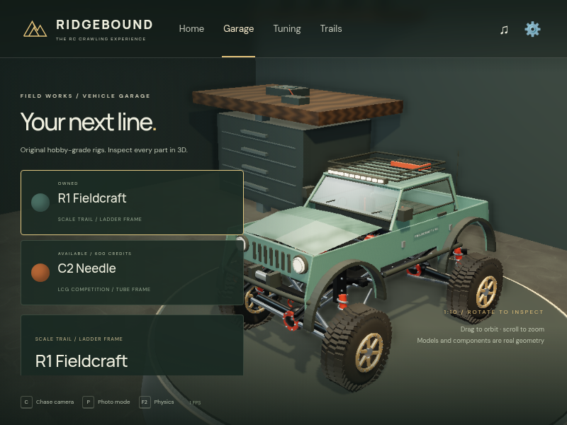
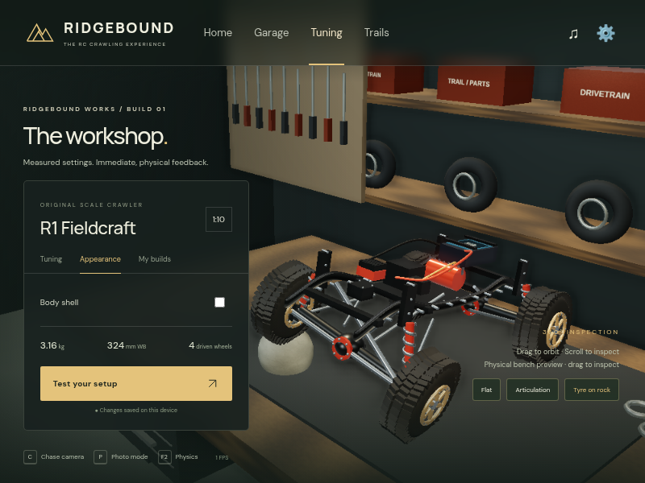

# Graphics, vehicles and environmental interaction upgrade

## Reference audit

Both split graphics archives were extracted and the instructions in each were read. There are **32 PNG files across five image folders**, including multi-panel reference sheets. Every file was decoded and examined in the five contact sheets; tyre contact, exposed chassis, garage, material and weather details were also examined at full image size. See [manifest with dimensions and SHA-256 hashes](graphics-references/manifest.json) and [contact sheets](graphics-references/). These images are art direction, not dimensional engineering data or runtime textures. The bundled instructions explicitly describe the images as AI-generated references.

The earlier 130-image pack remains reviewed in [REFERENCE_REVIEW.md](REFERENCE_REVIEW.md). The separate oversized **135-image realism archive** could not be transferred through the attachment tool's 32 MiB limit; the split graphics pack does not establish that those 135 files were examined. The two full pasted improvement prompts were read and combined with the latest request.

## Implemented

- Two original 1:10 bodies on a 324 mm wheelbase: **R1 Fieldcraft**, a compact hard-shell pickup with shaped hood, open arches, window seals, interior, clips, rack and recovery hardware; **C2 Needle**, an exposed triangulated tube-frame competition crawler with skid panels and a lower battery. Actual chassis/body masses differ by 310 g; C2's body centre of mass is 55 mm lower. The underlying axle dimensions are shared.
- Separate chassis rails, motor can, transmission, battery, ESC, servo, wiring, driveshafts, axle housings, linkages, shock towers, coil springs, rims and beadlock bolts. These are mesh assemblies, with moving components following physical transforms. Winch/recovery accessories are modeled but do not pull the vehicle. Shell visibility is an inspection control and retains the body collision/mass.
- The constrained 17-body/26-joint rig is retained. Each tyre now has **three independently compliant collision bands** and up to six local visual contact patches. Insert/compound stiffness changes physical compression and friction; lateral contact force drives bounded sidewall displacement. Rims remain rigid. Shadow geometry uses the same deformation shader.
- A separate vehicle-selection showroom with inspectable 3D previews, purchase/select/sell, stock comparison and cleaning. A distinct tuning bench has six physical categories, setup recipes, independent front/rear spring and compression controls, rebound, stroke, live steering and physical articulation/rock fixtures. Named builds and original saves remain compatible.
- Four measured courses in the connected park: **Fern Creek / Easy**, **Timberline / Medium**, **Granite Spine / Hard**, **Needle Point / Extreme**. Small gate markers, sequential forward crossings, times/scores, best records, credits and 20-second recovery penalties. Free roam and the physics proving ground remain available.
- A compact driving HUD and **M** pause menu; garages/tuning/maps/settings are separate screens. The menu pauses both physics and course time. Camera views, photo PNG export, remapping and mobile touch controls remain available.
- Original generated PBR albedo/normal/roughness maps for soil, moss, rock, mud, rubber, bark and steel; layered terrain shading with slope variation, localized mud and rain wetness. No reference images are used as vehicle billboards, backgrounds or flat scene textures. External photogrammetry downloads were unavailable, so these are generated materials, not sourced photographic scans.
- Contact/slip/surface-driven dirt, dust, gravel, mud and water particles; forward/reverse spin changes ejection direction. A bounded reusable particle pool provides gravity, drag, limited ground bounce and expiry. High/Ultra also draw instanced 3D dirt/gravel/mud clumps; lower presets retain cheaper sprites. Mud exposure persists per owned vehicle; creek water washes it off. Water entries create expanding fading ripples. Bounded tyre-tread stamps fade over time. Nearby fern geometry bends away from wheel positions and recovers as they move away.
- Clear, Overcast, Rain, Fog, Sunset and Night rendering. Rain changes surface grip through the same surface query on every graphics preset. Night enables actual vehicle spotlights. These are selectable weather states, not a meteorological simulation.
- **Low, Medium, High, Ultra, Auto and Custom** graphics settings. Actual controls cover render scale, shadow resolution, vegetation count, particle density, mark budget, water detail, visible dirt, ambient occlusion, bloom, optional macro depth of field, exposure, anisotropy, view distance, frame cap, dynamic resolution, FPS and HUD visibility. Ultra raises image scale, shadows, vegetation and effect budgets and enables SSAO/bloom. Auto and dynamic resolution use observed render times. They never change the 240 Hz physics rate or tyre/suspension tuning.

## Remaining work and accuracy limits

This is a substantial browser-game upgrade, **not a completed photorealistic production asset library**. Vehicle surfaces, vegetation and rocks still need artist-authored/scanned assets, higher-quality UV work, terrain blending and broader scene dressing to approach the supplied photographs. The two original bodies are detailed procedural models, not licensed manufacturer replicas. There are four courses within one park, not five finished biomes or ten distinct scale platforms.

Tyres use a reduced three-band radial model plus localized mesh deformation, not finite-element rubber, internal air pressure or a fully deformable tread carcass. Coil springs visually follow shock length rather than simulating individual steel coils. Soil stamps do not excavate physical ruts. Particles use ground-height collision and a fixed pool; they do not collide with every rock/body or simulate a granular soil bed. Water provides visual disturbances/washing and wet grip, not fluid simulation, buoyancy, underwater motor failure or screen-space reflections. Vegetation bending is visual, not rigid-body interaction.

No measured real-crawler calibration or hardware-wide frame-rate guarantee is claimed. Software-rendered Chromium validates WebGL behavior here, but cannot establish performance on a gaming GPU, mobile phone or Mac. Hardware gamepad, touch-device ergonomics and longer GPU/memory sessions still need device testing. The graphics panel deliberately exposes only implemented controls.

## Validation

`npm test` passes **36 tests**, including the retained 22 physical regressions and 14 new ownership/save/course/effect/compliance/bridge checks. Edge-contact tyre band deflections measured 10.46 / 0.67 / 0.68 mm in the new test. The preset independence check produces identical physical chassis positions across all four fixed graphics presets; the retained fixed-clock test also compares 30/60/120 render FPS.

The development browser smoke run passed 11 checks with no JavaScript or shader errors: 3D selection/purchase, real vehicle mass, paused showroom, live tuning/articulation/servo, paint/shell/builds, four courses and keyboard driving, clean HUD, pause/recovery, actual PNG export, custom graphics/weather, remapping, mobile touch, cleaning and reload persistence. Screenshots and machine-readable browser results are generated under ignored `.artifacts/`; reference contact sheets and the audit manifest are committed separately from the runtime bundle.

The final graphics browser run passed Low/Medium/High/Ultra/Auto, Custom depth of field, tyre/depth shaders, all six weather states and contact integration with no console or page errors. A physical gravel obstacle fixture generated 37 particle emissions; the mud-lane run increased dirt to 0.098, and creek immersion generated 26 ripple events while reducing retained dirt from 0.087 to 0.069. The pool remained bounded at 1,000 slots. These values demonstrate the specific test sequence, not real-world calibration or a target frame rate.

Ultra's inspected showroom frame used a 1.25 render scale, 2048 shadow maps, SSAO/bloom and full vegetation; Low used 0.75 scale, shadows/SSAO/bloom disabled and 35% vegetation. Auto selected Low on the software renderer. The observed multipass showroom totals were 459 draw calls / 266k triangles on Ultra versus 108 / 66k on Low. Outdoor workload is larger; these are rendering counters, not measured gaming-GPU FPS.

The final production-preview smoke test passed HTTP 200, bundled font/JavaScript/WASM initialization, main-menu shortcut handling, actual tyre contact on the corrected timber bridge, driving/camera controls, PNG download, pause/workshop transitions and small-screen action placement, with no JavaScript or WebGL errors. `npm run build` and `git diff --check` passed. Vite still warns about the large Rapier embedded-WASM vendor chunk; no warning was suppressed.

## Captures from the tested application

