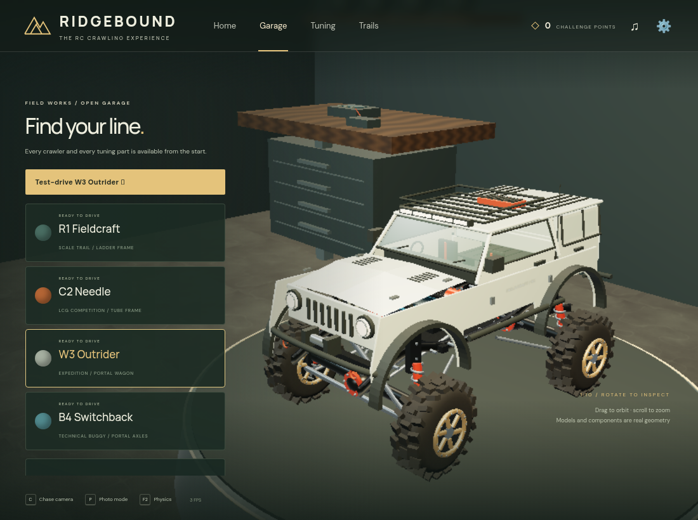
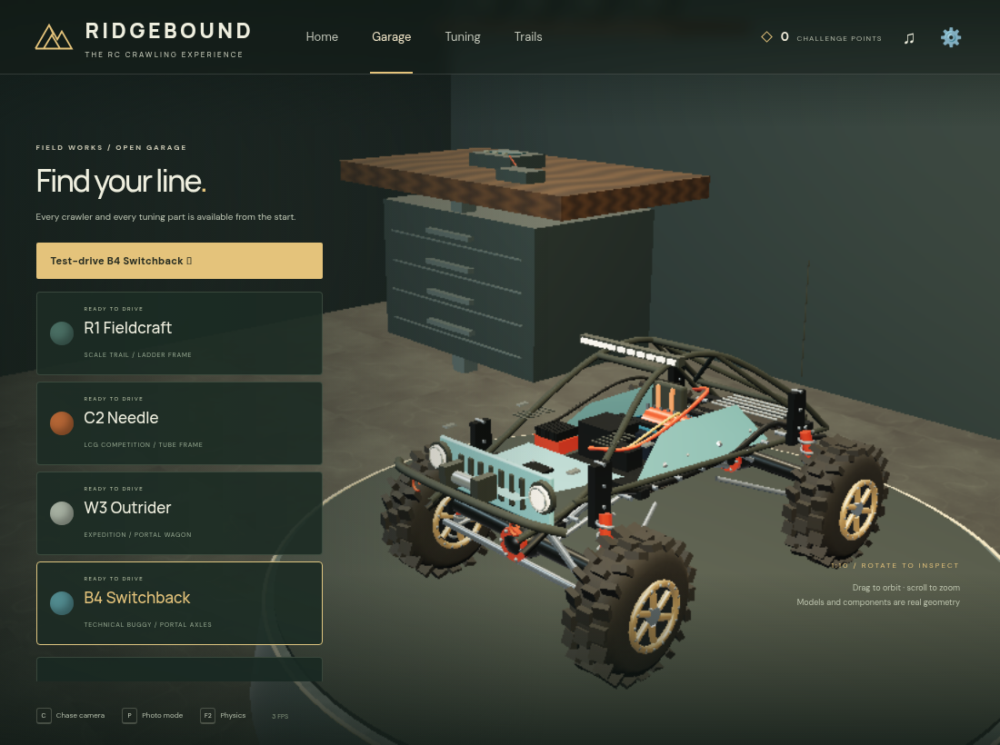
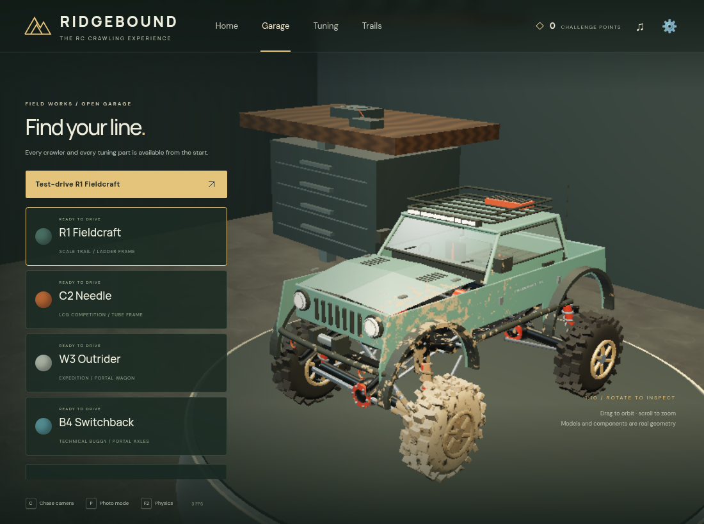

# Open garage and realism improvements

This report covers the new complete-game prompt after commit `24ad909`. The existing TypeScript / Three.js / Rapier stack, local version-1 saves, garage, separate workshop, four courses, photo mode and static Cloudflare build are retained.

## Delivered behavior

All **four** original vehicles are immediately available with zero challenge points. Prices, buying, selling and ownership checks were removed. Loading an old save unlocks every catalogue entry while preserving tuning, builds, records and legacy accumulated points. Points remain an optional challenge statistic and cannot gate a vehicle or tuning part. Each preview has an instant physical test-drive button.

The catalogue now includes the retained R1 Fieldcraft and C2 Needle, plus **W3 Outrider**, a closed expedition wagon with cargo glazing, full rear cabin, roof ribs and a treaded tailgate spare, and **B4 Switchback**, a narrow single-seat portal buggy with its own cage, cockpit and rear service deck. W3 uses ladder rails; the competition rigs use tube rails. Hood vents, panel hardware, motor/electronics, links, springs, shafts and beadlock hardware remain actual geometry. Different shell/chassis masses, battery placements, tyres, springs, stroke and axle layouts produce physical handling differences. All four use the existing 324 mm 1:10 platform; no pretend 1:24 or 1:6 entry was added.

New physical tuning covers **front overdrive, rear underdrive, chassis ballast mass/location, chassis link-mount height and two tread layouts**. Gear constraints and output torque use the ratios. Ballast changes actual mass/COM and is visible on the chassis. Link offsets move physical joint anchors and visible link endpoints. Tread selection changes the rendered lug arrangement and conservative surface-friction coefficients in the reduced tyre model. All original tuning categories, recipes and named builds remain free.

## Stability investigation and corrections

A parked flat-ground probe reproduced contact oscillation at soft insert settings. The old load-to-radius feedback changed the collision shape quickly using delayed solver contact loads; when a contact disappeared briefly, the radius immediately began recovering. That feedback could add geometric contact energy and repeatedly unload a tyre.

- The reduced compliance model now uses a slower viscoelastic loaded response, retains its compression through very small support gaps, and releases promptly when the tyre actually leaves support. It still changes physical rolling radius and the local visual contact patches; no upright force or chassis velocity clamp was added.
- Terrain trimeshes merge shared vertices and enable Rapier's internal-edge correction, reducing spurious collision normals at triangle seams. CCD permits four substeps for fast contacts.
- Initial placement and reset use the selected tyre radius, terrain samples at the four wheels, and actual static support across the footprint. Larger tyres and inclined terrain no longer inherit a stock-diameter centre-only spawn height.
- The old locked-differential projection omitted carrier inertia and was solved before terrain contact. The replacement solves coupled gear constraints after the contact solve, combines gradients for shared bodies, and applies equal/opposite angular impulses to wheels and their carriers. This conserves angular momentum and removes constraint-relative kinetic energy. It also supports the configured front/rear output ratios.

These changes improve the measured cases, rather than establishing that every terrain/setup combination is perfectly stable. The vehicle can still tip naturally; the model retains real weight transfer and suspension travel. Tyres remain a reduced three-band radial model, not a finite-element rubber carcass.

## Mud, dust, water and wear

The old uniformly distributed fine grain mask is replaced with **eight persistent exposure zones**: four tyres and four corresponding arch/lower-body regions. Actual wheel load, rolling speed, spin/slip and surface material drive deposition. Only exposed zones get muddy. A multiscale 3D noise shader forms irregular larger splatters, varied apparent thickness, different wet/dry colors, roughness and normal perturbation, plus dust deposits. The underside receives separate coverage. Nearby wheel positions locate the coating as the axles articulate.

Dry rolling contact now emits fine dust even without strong wheelspin; larger clumps still require slip. Existing bounded particles, gravity, track marks, vegetation bending and ripple pools are retained. Water washes immersed wheel/body zones at different rates. The garage offers a non-destructive clean preview, current finish view, and a free clean/reset action. Optional scuffs accumulate from chassis scrape work and can be hidden in settings. Per-vehicle mud, dust, wetness and scuffs survive reload; original scalar dirt saves migrate.

A **35 mm-deep water trough** with physical side walls was added to the proving ground. Its volume drives wet grip, water spray, washing and ripples. The proving ground now exposes turning, articulation, incline, sidehill, grip lanes, water, acceleration and measured rock sections. Existing four Easy/Medium/Hard/Extreme courses remain open. Checkpoint recovery returns to the last passed gate, preserves gate order and adds the existing challenge penalty; free roam returns to the trailhead without a penalty.

## Graphics, camera, audio and polish

- Generated material source maps are now 1024 pixels. Graphics presets actually resize uploaded PBR textures to 128 / 256 / 512 / 1024 pixels. Custom exposes that choice. These remain original procedural maps, not photographic scans or compressed authored texture packs.
- Wheel geometry has three real LODs (24/48/96 radial segments) and matching tread instance budgets. A separate visual tyre-deformation toggle leaves contact stiffness, collisions and forces unchanged. Other retained preset controls still govern shadows, vegetation, particles, marks, water, SSAO, bloom, scale and view distance. Full body/terrain LOD, GPU-compressed assets, reflection-quality and runtime antialiasing selection remain future work.
- Camera selection persists. Photo mode adds weather/light selection, real depth of field and manual focus alongside orbit/zoom, hidden UI and PNG export. Free positioning of a vehicle in a photographed scene is not implemented.
- Gesture-unlocked audio now includes filtered procedural rolling/gravel contact, water, scrape and quiet ambient-air layers alongside the existing load-responsive motor and servo tones. These are synthesized sounds, not recorded RC/forest samples; subjective audio quality and hardware speaker/controller/trackpad testing remain necessary.

## Scope still requiring work

This is a substantial functional upgrade, **not completion of all 25 sections of the aspirational prompt**. Production photorealistic vehicle/vegetation/terrain assets, a ten-vehicle collection, calibrated 1:24 and 1:6 rigs, alternate suspension geometries, four-wheel steering, advanced ESC simulation, physical tread-block deformation, volumetric accumulated mud, excavated soil, loose-leaf rigid bodies, hydrodynamics/buoyancy, broad separate quarry/mountain/rainforest maps, recorded sound libraries and a full hardware performance matrix remain further development. Existing image references remain separate from runtime textures/backgrounds.

The game is still deployable as static `dist/` assets using `npm run build`. A local build or GitHub push does not verify Cloudflare's deployment result.

## Validation

The numerical suite passes **46 tests, zero skipped**, including the retained physical regressions and new free-access migration, per-vehicle driving/reverse, local mud/washing, airborne rubber recovery, ballast/link anchors, overdrive, checkpoint recovery and graphics-independent physics checks. A single worker was used for the final run alongside software-rendered browser checks; the longer stability fixture has a 15-second timeout without changing its assertions.

After three seconds of settling, a five-second parked fixture measured **0.060 mm peak-to-peak chassis movement with stock inserts** and **0.650 mm with the softest inserts**. Stock retained all four contacts; the softest setup had one sample with fewer contacts out of 1,200. The earlier probe had measured roughly 2.5–6.5 mm over its observation window. These are controlled fixture results, not real-crawler calibration or proof of zero jitter everywhere.

The revised split-traction fixture measured locked axle-speed difference below 0.000001 rad/s, versus 0.173 rad/s with open differentials. The airborne 15% front-overdrive fixture measured front/rear relative speeds of 0.407/0.354 rad/s, matching the configured ratio. The retained 20-degree climbing, braking, rollover, steering/reverse and 30/60/120 render-FPS equivalence assertions pass.

The existing development browser smoke test passes 11 checks with no JavaScript/WebGL errors, including free C2 selection at zero points, tuning/articulation, builds, course driving, pause/recovery, real PNG export, graphics/weather/remapping, touch controls, cleaning and save reload. The new-feature browser run passes **7 checks**: every free vehicle physically drives with zero points; tread/ratio/ballast/link tuning responds; zoned mud, non-destructive comparison and cleaning work; the water trough produces immersion/wetness/ripples; photo light/DoF/focus work; texture resizing/wheel LOD/deformation toggles preserve physical compression; and new tuning/camera/wear/graphics preferences survive reload. No JavaScript or WebGL errors were recorded.

A separate rendered-pixel regression now verifies localized mud: coating one front wheel changes its sampled image region (RMS pixel difference about 40.7), while the opposite front wheel and visible clean rear wheel remain pixel-identical. This caught and corrected cross-side arch deposition and accidental coating of otherwise clean tyres by the underside mask. Reusable checks are `npm test`, `npm run build`, `npm run test:browser`, `npm run test:realism`, `npm run test:mud`, `npm run test:visual`, and `npm run test:production`. Browser checks require the documented dev/preview server and `/usr/bin/chromium`; software WebGL is not a gaming-GPU FPS measurement. The fixed clock retains its 250 ms long-stall catch-up cap and reports dropped time; real-time performance below four rendered frames per second is not guaranteed.

The final graphics run passes Low, Medium, High, Ultra, Auto and Custom DoF; exposed workshop tyre/depth shaders; all six weather states; and real contact-effect integration with no JavaScript/WebGL errors. The physical gravel fixture emitted 174 particles, mud exposure increased retained mud, and creek immersion generated 23 ripple events while reducing retained mud from 0.068 to 0.047. The pool stayed bounded at 1,000 slots. These figures describe a controlled fixture, not fluid/soil calibration.

The final production smoke test passes HTTP 200 and bundled fonts/JavaScript/WASM initialization, actual timber-bridge tyre contact, driving/camera switching, PNG download, pause/workshop navigation and small-screen action placement, with no console/page errors. `npm run build` passes; Vite's existing large Rapier/WASM chunk warning remains visible. `git diff --check` passes.

## Application captures

A 240-step production-browser benchmark of the full park collision world measured **1.0 ms median / 1.7 ms p95 / 5.8 ms maximum** per 240 Hz physics step in this run. It includes the articulated vehicle and new angular gear solve. It is a CPU-step timing, not a rendered-frame-rate guarantee.
