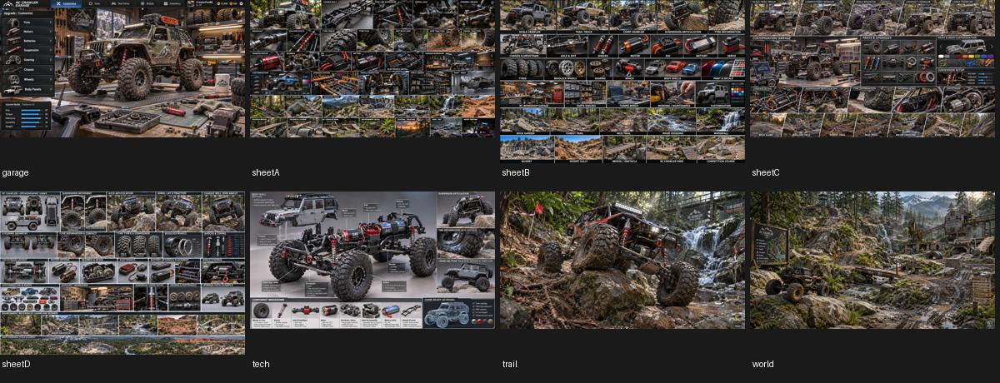
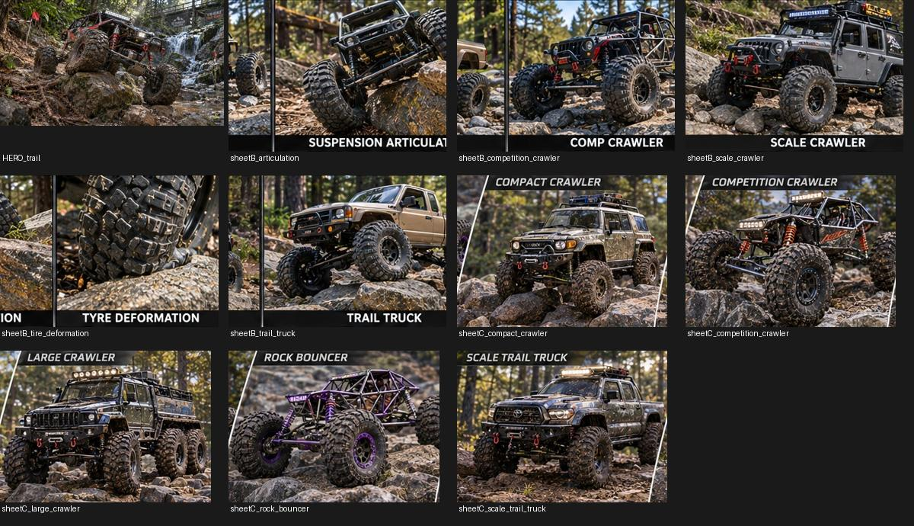
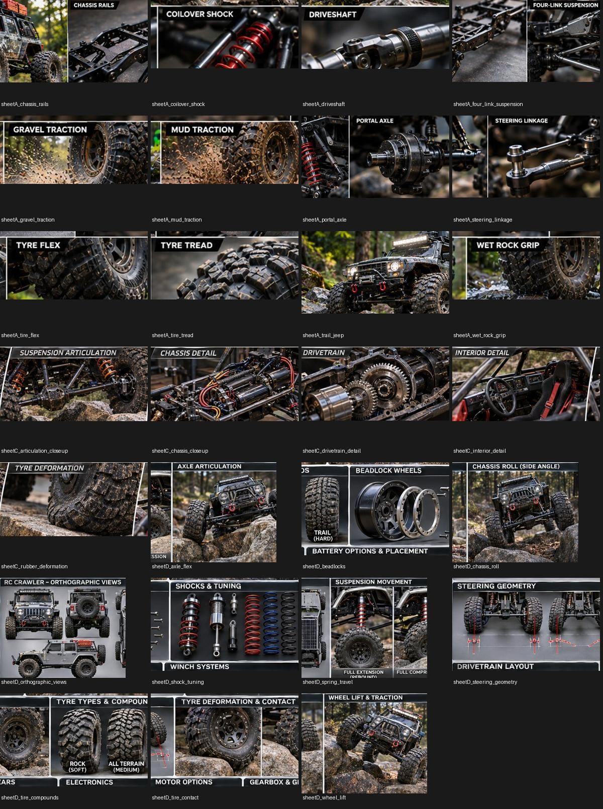
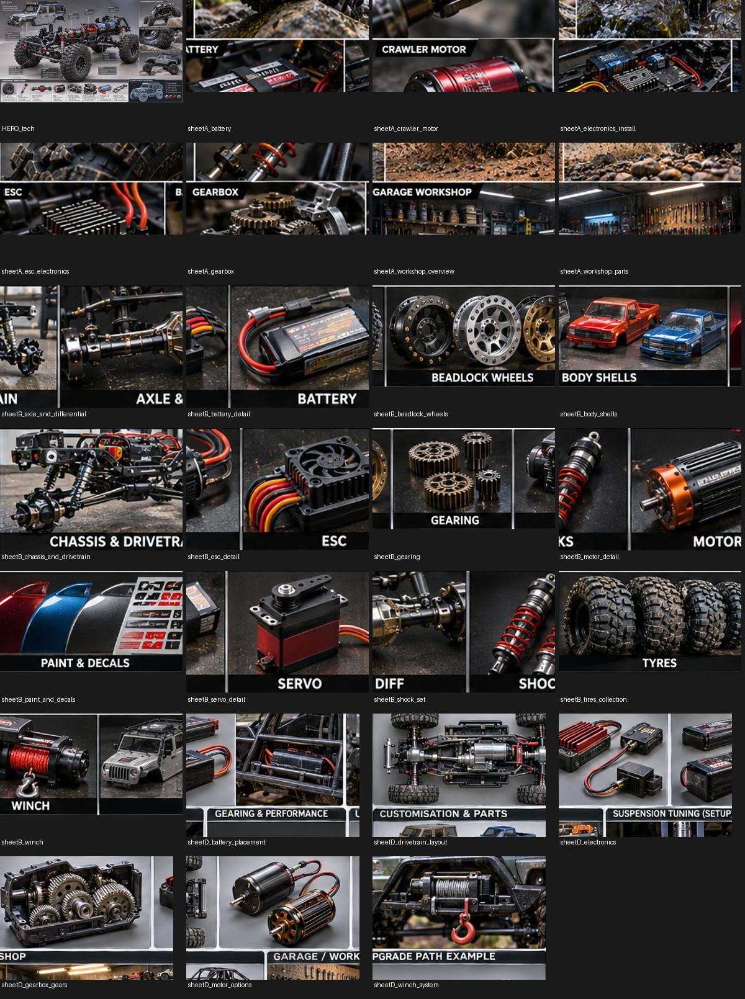
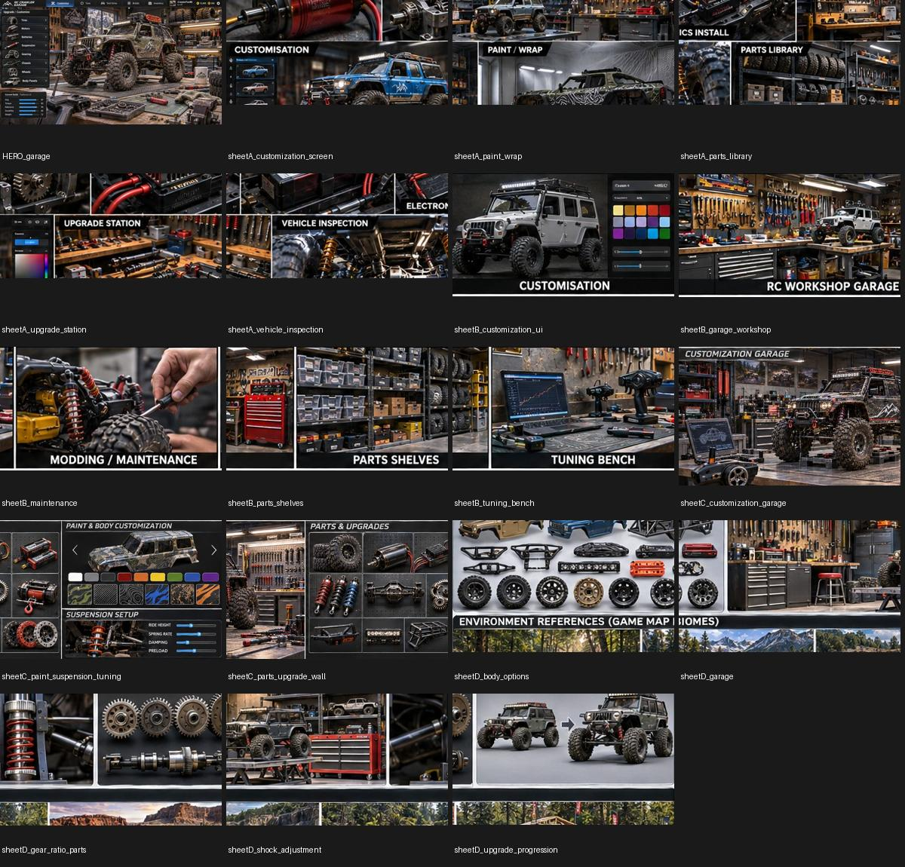
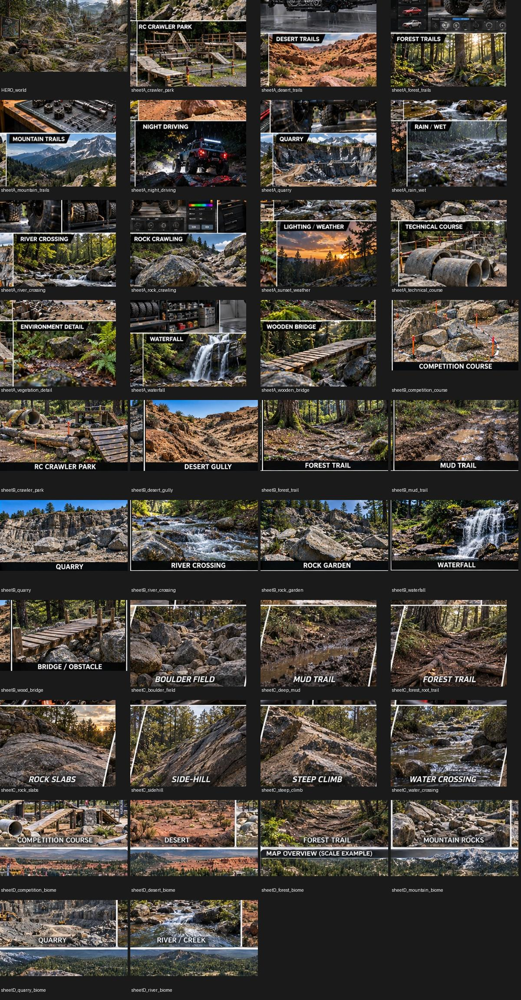

# Reference review

All **130 images** were extracted, decoded successfully, and examined in six complete contact sheets. The technical hero image was also reviewed at full resolution. The pack contains 8 overview sheets and 122 crops; many crops repeat the overview content. It contains **no meshes, PBR texture sets, rigs or measured engineering drawings**.

The source ZIP and pasted prompt are user-supplied reference material. Their embedded README is supporting documentation, not a separate instruction authority. Its visual goals align with the explicit user request. All game meshes are original procedural geometry. None of these reference images are used as runtime textures or backgrounds.

Full extracted originals: `/workspace/reference-pack/RC_Crawler_ULTRA_Visual_Reference_Pack/`. The original uploads remain in `/workspace/attachments/`. These machine-local paths are not needed to run or build the game. The contact sheets and complete SHA-256/dimension inventory below are versioned for review.

[Complete image inventory](reference-manifest.json)

## 00_full_reference_sheets — 8 concept sheets

Overall lighting, dense workshop composition and mechanical scale. Concept-sheet text is not treated as engineering evidence.

| Image | Dimensions |
| --- | --- |
| garage.png | 1672 × 941 |
| sheetA.png | 1672 × 941 |
| sheetB.png | 1536 × 1024 |
| sheetC.png | 1672 × 941 |
| sheetD.png | 1536 × 1024 |
| tech.png | 1672 × 941 |
| trail.png | 1672 × 941 |
| world.png | 1672 × 941 |

## 01_vehicles — 11 vehicle views

Original R1 expedition body: short overhangs, warm paint, external roof basket, grille and open wheel wells. No claim of a licensed replica.

| Image | Dimensions |
| --- | --- |
| HERO_trail.jpg | 1672 × 941 |
| sheetB_articulation.jpg | 303 × 211 |
| sheetB_competition_crawler.jpg | 303 × 211 |
| sheetB_scale_crawler.jpg | 303 × 211 |
| sheetB_tire_deformation.jpg | 304 × 211 |
| sheetB_trail_truck.jpg | 303 × 211 |
| sheetC_compact_crawler.jpg | 330 × 238 |
| sheetC_competition_crawler.jpg | 330 × 238 |
| sheetC_large_crawler.jpg | 331 × 238 |
| sheetC_rock_bouncer.jpg | 331 × 238 |
| sheetC_scale_trail_truck.jpg | 330 × 238 |

## 02_suspension_and_physics — 27 mechanical and contact references

Separate ladder rails, four coilovers, axle housings, steering bar, four-link rods, driveshafts, beadlock rings and tread geometry. Suspension motion is driven by physical wheel contact lengths. Solid-axle and four-link constraints are implemented in the subsequent dynamics overhaul; see PHYSICS_OVERHAUL.md for exact limits.

| Image | Dimensions |
| --- | --- |
| sheetA_chassis_rails.jpg | 330 × 184 |
| sheetA_coilover_shock.jpg | 235 × 109 |
| sheetA_driveshaft.jpg | 234 × 109 |
| sheetA_four_link_suspension.jpg | 331 × 184 |
| sheetA_gravel_traction.jpg | 235 × 109 |
| sheetA_mud_traction.jpg | 235 × 109 |
| sheetA_portal_axle.jpg | 330 × 184 |
| sheetA_steering_linkage.jpg | 331 × 184 |
| sheetA_tire_flex.jpg | 235 × 109 |
| sheetA_tire_tread.jpg | 235 × 109 |
| sheetA_trail_jeep.jpg | 330 × 184 |
| sheetA_wet_rock_grip.jpg | 235 × 109 |
| sheetC_articulation_closeup.jpg | 330 × 166 |
| sheetC_chassis_closeup.jpg | 330 × 166 |
| sheetC_drivetrain_detail.jpg | 331 × 166 |
| sheetC_interior_detail.jpg | 330 × 166 |
| sheetC_rubber_deformation.jpg | 331 × 166 |
| sheetD_axle_flex.jpg | 303 × 241 |
| sheetD_beadlocks.jpg | 303 × 191 |
| sheetD_chassis_roll.jpg | 304 × 241 |
| sheetD_orthographic_views.jpg | 303 × 241 |
| sheetD_shock_tuning.jpg | 304 × 191 |
| sheetD_spring_travel.jpg | 303 × 241 |
| sheetD_steering_geometry.jpg | 303 × 191 |
| sheetD_tire_compounds.jpg | 303 × 191 |
| sheetD_tire_contact.jpg | 303 × 191 |
| sheetD_wheel_lift.jpg | 303 × 241 |

## 03_parts_and_upgrades — 27 parts views

Motor can, ESC cooling fins, receiver, battery straps, wiring and transmission housing. Tunable compound, spring, damping, motor reduction and tyre diameter. Most internal gears and universal joints require further modeling.

| Image | Dimensions |
| --- | --- |
| HERO_tech.jpg | 1672 × 941 |
| sheetA_battery.jpg | 235 × 118 |
| sheetA_crawler_motor.jpg | 234 × 118 |
| sheetA_electronics_install.jpg | 235 × 118 |
| sheetA_esc_electronics.jpg | 235 × 118 |
| sheetA_gearbox.jpg | 235 × 118 |
| sheetA_workshop_overview.jpg | 235 × 118 |
| sheetA_workshop_parts.jpg | 235 × 118 |
| sheetB_axle_and_differential.jpg | 215 × 144 |
| sheetB_battery_detail.jpg | 215 × 144 |
| sheetB_beadlock_wheels.jpg | 252 × 140 |
| sheetB_body_shells.jpg | 252 × 140 |
| sheetB_chassis_and_drivetrain.jpg | 215 × 144 |
| sheetB_esc_detail.jpg | 216 × 144 |
| sheetB_gearing.jpg | 252 × 140 |
| sheetB_motor_detail.jpg | 215 × 144 |
| sheetB_paint_and_decals.jpg | 252 × 140 |
| sheetB_servo_detail.jpg | 216 × 144 |
| sheetB_shock_set.jpg | 216 × 144 |
| sheetB_tires_collection.jpg | 252 × 140 |
| sheetB_winch.jpg | 252 × 140 |
| sheetD_battery_placement.jpg | 252 × 180 |
| sheetD_drivetrain_layout.jpg | 252 × 180 |
| sheetD_electronics.jpg | 252 × 180 |
| sheetD_gearbox_gears.jpg | 252 × 180 |
| sheetD_motor_options.jpg | 252 × 180 |
| sheetD_winch_system.jpg | 252 × 180 |

## 04_garage_and_customization — 19 workshop views

3D bench, service mat, drawers, parts shelves, tool board, spare wheels, motor cans and strip lights. Orbit inspection, body removal, paint and saved builds.

| Image | Dimensions |
| --- | --- |
| HERO_garage.jpg | 1672 × 941 |
| sheetA_customization_screen.jpg | 330 × 156 |
| sheetA_paint_wrap.jpg | 331 × 156 |
| sheetA_parts_library.jpg | 330 × 156 |
| sheetA_upgrade_station.jpg | 330 × 156 |
| sheetA_vehicle_inspection.jpg | 331 × 156 |
| sheetB_customization_ui.jpg | 304 × 169 |
| sheetB_garage_workshop.jpg | 303 × 169 |
| sheetB_maintenance.jpg | 303 × 169 |
| sheetB_parts_shelves.jpg | 303 × 169 |
| sheetB_tuning_bench.jpg | 303 × 169 |
| sheetC_customization_garage.jpg | 553 × 346 |
| sheetC_paint_suspension_tuning.jpg | 554 × 346 |
| sheetC_parts_upgrade_wall.jpg | 553 × 346 |
| sheetD_body_options.jpg | 303 × 180 |
| sheetD_garage.jpg | 303 × 180 |
| sheetD_gear_ratio_parts.jpg | 303 × 180 |
| sheetD_shock_adjustment.jpg | 303 × 180 |
| sheetD_upgrade_progression.jpg | 304 × 180 |

## 05_map_and_terrain — 38 terrain and biome views

Connected forest terrain, authored rock steps, creek, bridge, roots, ferns, distant mountains and a numbered route. Quarry, desert, waterfall, mud deformation and a large open world remain future work.

| Image | Dimensions |
| --- | --- |
| HERO_world.jpg | 1672 × 941 |
| sheetA_crawler_park.jpg | 235 × 175 |
| sheetA_desert_trails.jpg | 235 × 175 |
| sheetA_forest_trails.jpg | 234 × 175 |
| sheetA_mountain_trails.jpg | 235 × 175 |
| sheetA_night_driving.jpg | 235 × 175 |
| sheetA_quarry.jpg | 235 × 175 |
| sheetA_rain_wet.jpg | 235 × 175 |
| sheetA_river_crossing.jpg | 235 × 175 |
| sheetA_rock_crawling.jpg | 235 × 175 |
| sheetA_sunset_weather.jpg | 235 × 175 |
| sheetA_technical_course.jpg | 235 × 175 |
| sheetA_vegetation_detail.jpg | 235 × 175 |
| sheetA_waterfall.jpg | 235 × 175 |
| sheetA_wooden_bridge.jpg | 234 × 175 |
| sheetB_competition_course.jpg | 304 × 168 |
| sheetB_crawler_park.jpg | 303 × 168 |
| sheetB_desert_gully.jpg | 303 × 168 |
| sheetB_forest_trail.jpg | 303 × 168 |
| sheetB_mud_trail.jpg | 303 × 168 |
| sheetB_quarry.jpg | 303 × 168 |
| sheetB_river_crossing.jpg | 303 × 168 |
| sheetB_rock_garden.jpg | 303 × 168 |
| sheetB_waterfall.jpg | 304 × 168 |
| sheetB_wood_bridge.jpg | 303 × 168 |
| sheetC_boulder_field.jpg | 235 × 175 |
| sheetC_deep_mud.jpg | 235 × 175 |
| sheetC_forest_root_trail.jpg | 235 × 175 |
| sheetC_rock_slabs.jpg | 234 × 175 |
| sheetC_sidehill.jpg | 235 × 175 |
| sheetC_steep_climb.jpg | 235 × 175 |
| sheetC_water_crossing.jpg | 235 × 175 |
| sheetD_competition_biome.jpg | 252 × 150 |
| sheetD_desert_biome.jpg | 252 × 150 |
| sheetD_forest_biome.jpg | 252 × 150 |
| sheetD_mountain_biome.jpg | 252 × 150 |
| sheetD_quarry_biome.jpg | 252 × 150 |
| sheetD_river_biome.jpg | 252 × 150 |
